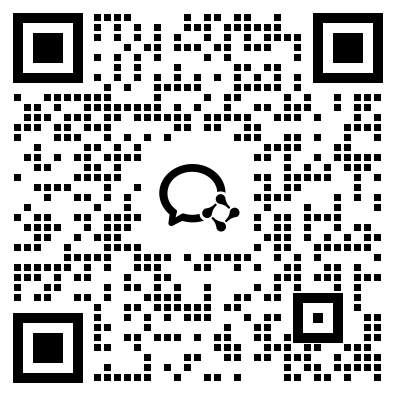
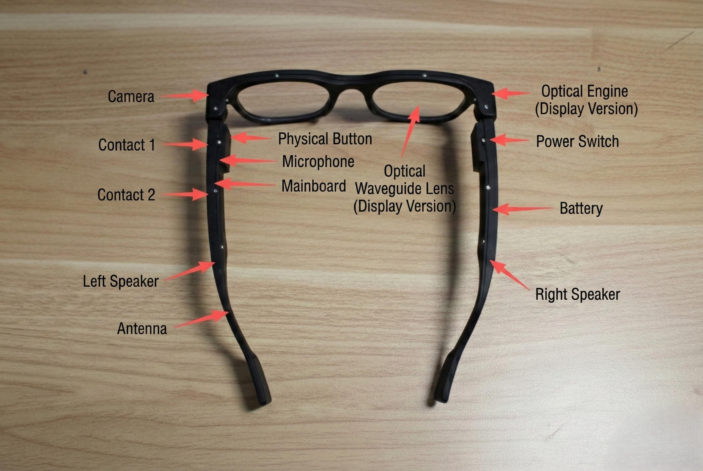

# 🥽 AI スマートグラス

> [!IMPORTANT]
> # 🚧 ドキュメントは現在追加中です 🚧


**医療、産業、教育、コンシューマー向けの、Linux ベースのオープンソーススマートグラスプラットフォーム**

[中文](README.zh.md) | [English](README.md) | **日本語**

[](https://github.com/ezxrdev/OpenSource-Ai-Glasses/actions)
[](LICENSE)
[](https://github.com/Iam5tilllearning/OpenSource-Ai-Glasses/releases)


---


## 📋 プロジェクト概要

これは Linux ベースのオープンソーススマートグラスプロジェクトで、まだ開発の初期段階にあります（ドキュメントの完成度は 45%）。

オープンソースの対象は主にシステムソフトウェアとアプリケーションスタックです。開発は私たちの統合ハードウェアキットに限定されません。RV1106B ベースの開発ボードであればどれでも出発点として使え、ご自身のハードウェア設計に合わせて周辺機器を適合させることができます。

**開発者コミュニティ** | **連絡先**: iam5tilllearning@foxmail.com

| WeChat グループ | Discord コミュニティ |
|:---:|:---:|
|  | <a href="https://discord.gg/9AYus36rXH">Discord に参加</a> |
| スキャンして WeChat グループに参加 | [Discord に参加](https://discord.gg/9AYus36rXH) |


## 🧩 ハードウェアの選択肢

このプロジェクトは、次の 2 つの方法で開発できます。

- ご自身の RV1106B ベースの開発ボードを使い、オープンソースのシステムとソフトウェアスタックを開発する。この方法は安価ですが、立ち上げ時に多くの問題が起こる可能性があり、システムの互換性やドライバーなどの問題にかなりの時間を費やすことがあります。AI グラスの操作アプリケーションをすばやく開発したい場合は、私たちが入念に調整した AI グラスのデバイスの購入をおすすめします。
- 配線済みの周辺機器、プリインストールされたファームウェア、少ないハードウェア統合作業で、より速く立ち上げたい場合は、私たちの深く統合された AI グラスキットを使う。

[**任意：公式 AI グラスキットを入手する**](https://item.taobao.com/item.htm?id=1007109700786) — *より速い立ち上げにおすすめですが、開発に必須ではありません*

[**予備の購入リンク**](https://item.taobao.com/item.htm?ft=t&id=1056653633568) — *メインの購入ページが利用できない場合はこちらをご利用ください*

> [!CAUTION]
> **公式ハードウェアの互換性に関するお知らせ**: v0.6.x および v0.7.x のリファレンスファームウェアは、**2026 年 1 月 1 日以降に製造された統合ハードウェアにのみ対応しています**。公式キットや同じリファレンスのハードウェアをこの日付より前に購入または製造した場合は、v0.6.0 以前のファームウェアをご使用ください。

## ✅ 現在のバージョンの機能（v0.7.0）

- **ファームウェアのバージョン: v0.7.0**
  - 2026 年 1 月 1 日以降に製造された新しいハードウェアに対応しています。
- **OSAIG モバイルクライアント**: OSAIG グラスの接続、管理、デバッグのための、初の独立した Android モバイルクライアントをリリースしました。
- **デバイス管理**: デバイスのバインド、デバイス一覧の管理、オンライン/ローカルの接続状態、デバイスの詳細ページ、ステータスの推移、そしてバッテリー、ストレージ、メモリ、システムバージョンなどのデバイスの基本情報に対応しています。
- **RTSP リアルタイム映像ストリーミング**: グラスはカメラ映像を RTSP で公開でき、モバイルクライアントやクラウド側の映像 AI 認識パイプラインで利用できます。リファレンスのメインストリームは `rtsp://<device_lan_ip>:554/live/0` です。
- **BLE テキスト通信**: BLE テキストチャネルと、モバイル側の BLE デバッグ用エントリーを追加し、プリセットのコマンドやテキストをグラスに送信できるようにしました。
- **オーディオデバイス処理のリファクタリング**: オーディオの入出力の連携を改善し、録音と再生を同時に行えるようにしました。
- **SDK の更新**: SDK のドキュメントで、録音の制御、AI-Core の物理アクションの制御/照会、メディアリソースの調停、ディスプレイへの描画内容の送信、テキストイベントの購読、BLE テキストの送受信、更新されたサンプルのビルドエントリーを扱うようになりました。
- **リリースアセット**:
  - `Firmware_RV1106B_RK962_IMX219.AudioVersion.img`
  - `Firmware_RV1106B_RK962_IMX219.DisplayVersion.img`
  - `osaig-0.3.0+7-release.apk`
- **リリースの詳細**: <https://github.com/Iam5tillLearning/OpenSource-Ai-Glasses/releases/tag/v0.7.0>

<details>
<summary>📜 バージョン履歴の概要</summary>

### v0.7.0 (2026-05-08)
- デバイスのバインド、管理、デバッグ、アップデートの案内、デバイス情報、ステータスの推移に対応した、初の独立した OSAIG モバイルクライアントを追加しました。
- グラスのカメラ映像の RTSP リアルタイムストリーミングを追加しました。モバイルクライアントでは、エンドツーエンド/ネットワーク/再生の遅延の指標を見ながらストリームを視聴でき、開発者はクラウド側の映像 AI 認識パイプラインから RTSP フィードを利用することもできます。
- モバイルクライアントからの BLE テキスト通信を追加しました。プリセットのデバッグコマンドと、将来の写真、動画、デバイス制御、デバッグの拡張に向けて予約したコマンド構造を含みます。
- オーディオデバイスの処理をリファクタリングし、録音と再生の共存を改善して、音声操作や音声・映像のデバッグのためのより強固な基盤を用意しました。
- BLE テキストの送受信、録音の制御、物理アクションの制御/照会、メディアリソースの調停、ディスプレイへの描画内容の送信、テキストイベントの購読について、SDK のドキュメントを追加しました。
- リリースアセットには、AudioVersion/DisplayVersion の両方のファームウェアイメージと、OSAIG の Android APK `osaig-0.3.0+7-release.apk` が含まれます。

### v0.6.5 (2026-03-16)
- プロジェクト全体の複数の安定性の問題を修正しました。特に AI Core サービスの信頼性に重点を置いています。
- エッジケースや予期しない障害の処理を強化しました。
- AudioVersion と DisplayVersion の 2 つのリリース版を追加しました（ハードウェアの種類に応じて選択します）。

### v0.6.4 (2026-02-10)
- ディスプレイ搭載版の機能をアップグレードし、新しいシステムレベルの `display-service` を追加しました。
- アプリケーション開発 SDK と統合し、サードパーティによるグラフィックの描画と表示に対応しました。
- グラフィカルな操作フローのための実験的な `launcher-app` デモを追加しました。
- `display-service` と `launcher-app` はどちらも完全にオープンソース化されており、学習やカスタマイズに利用できます。

### v0.6.3
- ファームウェアのバージョン: v0.6.3
- Bluetooth に対応しました（Bluetooth 名: OSAIG）
- 注意: Xiaomi のスマートフォンには互換性の問題があります
- ディスプレイ版をお使いの方は、表示の問題を手動で対処する必要があります

### v0.6.2
- ファームウェアのバージョン: v0.6.2
- SDK: ディスプレイモジュール（UI/画像）と省電力設定を追加しました
- SDK: ASR と LLM のテキストを取得する機能を追加しました
- 30 秒で画面が自動的に消えるロジックを最適化しました
- GPIO Hub アーキテクチャにアップグレードしました
- 3D モデルの構造を最適化しました
- cJSON を追加し、古いディスプレイアプリを削除しました

### v0.6.1
- ファームウェアのバージョン: v0.6.1
- 2026 年 1 月 1 日以降に製造された新しいハードウェアに対応しました

### v0.6.0
- ファームウェアのバージョン: v0.6.0
- 新しい SDK をリリースしました

### v0.5.0
- ファームウェアのバージョン: v0.5.0
- Wi-Fi のプロビジョニングのロジックを一通り実装しました
- 詳しい音声ガイダンスを追加しました

### v0.4.0
- コアサーバーをベースにした SDK を用意しました
- 開発者はこの SDK を使って、写真撮影、GPIO、録音などを実装できます

### v0.3.1
- システムセンチネルを実装しました

### v0.3.0
- 写真撮影、GPIO、録音、新しい AI 会話を担うコアサーバーを実装しました

### v0.2.3
- ケーブルスロットのレイアウトを最適化しました

### v0.2.2
- グラスのフロントフレームのモデルを変更し、光学エンジンと導波路の位置を確保しました

### v0.2.1
- テンプル（つる）のモデルを変更し、音響キャビティとアンテナキャビティを確定しました

### v0.2.0
- フレームの 3D プリントによる成形の初版

### v0.1.1
- AI 会話の遅延を大幅に改善し、最初のパケットのエンドツーエンド遅延を約 1 秒にしました

### v0.1.0
- 基本的な AI 会話を実装しました

</details>

## 🔍 ハードウェアのレイアウト



## ✨ 主な特徴

- 🖥️ **ディスプレイ**: 30°FOV、640×480 の単眼ディスプレイ（オプション）
- 📸 **カメラ**: 1080P の動画撮影と RTSP リアルタイム映像ストリーミング
- 🔊 **オーディオ**: マイクとスピーカーのシステム
- 📡 **接続性**: Wi-Fi 802.11b/g/n、Bluetooth 5.3、USB 2.0
- ⚡ **性能**: シングルコアの Cortex-A7、8GB のストレージ
- 🔋 **バッテリー**: 180mAh。音楽再生 2 時間、ディスプレイ表示 3 時間、録画 45 分
- ⚖️ **軽量**: わずか 43g
- 🧠 **センサー**: オプションの地磁気センサー、IMU
- 🐧 **OS**: 組み込み Linux ベースのシステム

## 🚀 クイックスタート

> **💡 注意**: 上記の[公式 AI グラスキット](https://item.taobao.com/item.htm?id=1007109700786)を購入した場合は、ファームウェアがプリインストールされており、すぐに使えます。ご自身の RV1106B ボードで開発する場合は、以下のホストのセットアップと書き込みのガイドから始めてください。

### ネイティブのホスト環境を使う（推奨）

Ubuntu/Debian のホスト、または Windows の WSL2 上で動く Ubuntu/Debian で直接開発することをおすすめします。

> **開発環境の唯一の入手先**: `https://github.com/makevary/AIGLASS_DEV_ENV`

```bash
# Get development environment
git clone https://github.com/makevary/AIGLASS_DEV_ENV.git
cd AIGLASS_DEV_ENV

# Fix/install build dependencies (Debian/Ubuntu and WSL2 Debian/Ubuntu)
./setup_build_env.sh

# Build firmware (choose one command only)
./build.sh
./build.sh --without-display

# Firmware output
ls -lh output/image/update.img
```

ビルドオプションの選び方:
- ディスプレイ機能のあるデバイス: `./build.sh`
- ディスプレイ機能のないデバイス: `./build.sh --without-display`

> **注意**: `setup_build_env.sh` は `apt-get` に依存しているため、Debian/Ubuntu システム（WSL2 上の Ubuntu/Debian を含む）に対応しています。

詳しくは[開発環境セットアップガイド](docs/ENV_SETUP.en.md)を参照してください。

**ファームウェアの書き込み**: コンパイル後、[ファームウェア書き込みガイド](docs/FIRMWARE_FLASHING.en.md)を参照して、ファームウェアをデバイスに書き込んでください。

**アプリケーション開発**: ホスト環境には、ユーザーレベルのアプリケーションのための一通りの開発フローが用意されています。詳しくは[アプリケーション開発ガイド](docs/APPLICATION_DEVELOPMENT.en.md)を参照してください。


## 📖 使い方ガイド

### 1. ネットワークの設定
- **自動**: デバイスは起動時に自動的にネットワーク設定モードに入ります。
- **手動**: いつでもボタンを 10 回続けて短く押すと、手動でネットワーク設定モードに入ります。
- **現在の方法**: Android スマートフォンで Wi-Fi の QR コードを共有し、グラスにその QR コードを読み取らせて接続します。
- **周波数帯の制限**: 2.4GHz の Wi-Fi のみ対応しています。5GHz/5G の Wi-Fi には対応していません。
- **アプリの状況**: 独立した OSAIG の Android モバイルクライアントは、v0.7.0 のリリースアセットから入手できます。現在は、デバイスのバインド、管理、デバッグ、アップデートの案内、BLE のデバッグ、リアルタイム映像の視聴を中心にしています。

### 2. クラウド AI 向けの RTSP 映像ストリーミング

- **メインストリーム**: `rtsp://<device_lan_ip>:554/live/0`
- **サブストリーム**: `rtsp://<device_lan_ip>:554/live/1`
- **主な用途**: クラウド側の映像 AI 認識、リモート点検、映像によるデバッグ、モバイルでのライブプレビュー。
- **ガイド**: [RTSP 映像ストリーミングガイド](docs/RTSP_VIDEO_STREAMING.en.md)

### 3. AI 会話
- **操作**: 設定後、左のテンプルのボタンを長押しして話し、離すと送信されます。AI の応答を待ってください。


## 📦 SDK 開発

このプロジェクトは、開発者が下層のハードウェア機能に簡単にアクセスして独自のアプリケーションを作れる、一通りそろった C/C++ SDK を提供しています。

**SDK の主な機能:**
*   **GPIO イベントの購読**: ボタンの押下などの GPIO イベントに低遅延でアクセス
*   **カメラへのアクセス**: 共有メモリによるゼロコピーでの画像データの取得
*   **オーディオの制御**: 音声の再生、TTS、録音の開始/停止/状態の取得、録音と再生の共存の改善
*   **物理アクションの制御**: GPIO イベントの配信を維持したまま、AI-Core の物理ボタンによる処理を有効化、無効化、照会
*   **メディアリソースの調停**: 外部アプリケーションのために、カメラやオーディオのリソースの解放や再取得を AI-Core に要求
*   **ディスプレイへの描画内容の送信**: 共有メモリのフレームバッファの送信と、ディスプレイのフォーカス管理
*   **テキストイベントの購読**: ASR、LLM、システムのテキストイベントを購読
*   **BLE テキストチャネル**: グラスの BLE ゲートウェイを通じて UTF-8 の JSON テキストメッセージを送受信
*   **プロセス間通信**: Unix ドメインソケットに基づく信頼性の高い通信

**v0.7.0 での SDK ドキュメントの更新:**
*   BLE テキストクライアントの API ドキュメントと、`ai_ble.h` ヘッダーの項目を追加しました。
*   録音制御の API を追加しました: `ai_audio_record_start()`、`ai_audio_record_stop()`、`ai_audio_record_get_status()`。
*   物理アクションの制御/照会の API を追加しました: `ai_audio_set_disable_aicore_physical_actions()` と `ai_audio_get_disable_aicore_physical_actions()`。
*   カメラやオーディオの解放、再開、状態の照会のための、メディアリソース調停の API を追加しました。
*   現場での確認時に実行時の状態を変えないよう、照会のみを行う物理アクションのサンプルを追加しました。
*   サンプルを、ビルド済みの SDK ライブラリにリンクし、統一されたビルド出力ディレクトリを使うように更新しました。

**SDK の場所**: [`SDK/ai_glass_sdk`](SDK/ai_glass_sdk)

**リソースの案内:**
*   📖 [SDK ドキュメント](SDK/ai_glass_sdk/README.en.md) - SDK の詳しい説明と使い方
*   📚 [API リファレンス](SDK/ai_glass_sdk/docs/README.en.md) - 詳しい API ドキュメント
*   💡 [サンプル](SDK/ai_glass_sdk/examples) - GPIO、カメラ、オーディオなどの完全なサンプルコード

**統合ガイド:**
アプリケーションで SDK をリンクして使う方法については、[SDK README](SDK/ai_glass_sdk/README.en.md#3-integrate-into-your-project) の「Integration」セクションを参照してください。


## 🏗️ システムアーキテクチャ


## 📚 ドキュメント

- [📖 ユーザーマニュアル](docs/USER_GUIDE.en.md) - グラスを組み立てた後にお読みください
- [🧰 開発環境セットアップガイド](docs/ENV_SETUP.en.md) | [中文](docs/ENV_SETUP.md)
- [💻 アプリケーション開発ガイド](docs/APPLICATION_DEVELOPMENT.en.md) | [中文](docs/APPLICATION_DEVELOPMENT.md)
- [📡 RTSP 映像ストリーミングガイド](docs/RTSP_VIDEO_STREAMING.en.md) | [中文](docs/RTSP_VIDEO_STREAMING.md)
- [⚡ ファームウェア書き込みガイド](docs/FIRMWARE_FLASHING.en.md) | [中文](docs/FIRMWARE_FLASHING.md)

## 🛠️ 開発

### ソースからのビルド

```bash
# Get the full development workspace
git clone https://github.com/makevary/AIGLASS_DEV_ENV.git
cd AIGLASS_DEV_ENV

# Install/fix build dependencies
./setup_build_env.sh

# Build firmware
./build.sh

# Output image
ls -lh output/image/update.img
```

### 開発ツール

- **IDE**: C/C++ 拡張機能を入れた VS Code
- **デバッガー**: GDB + OpenOCD
- **プロファイラー**: perf、valgrind
- **バージョン管理**: Git

### API の概要

```c
#include "ai_glasses_api.h"

// Initialize device
int device_init(device_config_t *config);

// Capture photo
int capture_photo(const char *filename);

// Display text
int display_text(const char *text, int x, int y);

// Play audio
int play_audio(const char *filename);

// Get sensor data
int get_sensor_data(sensor_data_t *data);
```

## 🎯 ユースケース

### 🏥 医療分野での活用

<details>
<summary>医療向け AI スマートグラスのシナリオ</summary>

#### 患者情報の表示
医師や看護師が病室に入ると、患者の氏名、ベッド番号、主な診断、アレルギー歴、主要なバイタルサインが視界の隅にすぐに表示されるため、カルテやコンピューターを何度も確認する必要がなくなります。

#### バイタルサインのリアルタイム監視
グラスは、ベッドサイドモニターや輸液ポンプのデータをリアルタイムに読み取って統合できます。患者の心拍数、血中酸素、血圧などの指標に異常な変動があると、システムはすぐに視界の中で警告を強調表示し、骨伝導ヘッドホンから穏やかながらはっきりとした警告音を鳴らします。

#### 操作の補助と手順の確認
点滴や投薬などの操作を行うとき、グラスのカメラが薬のバーコードと患者のリストバンドを自動的に読み取り、「三査七対」の情報を照合します。薬の用量の誤り、患者の取り違え、アレルギーのリスクが見つかると、すぐに目立つ形で警告が表示され、医療過誤を防ぎます。

#### 非接触での情報アクセス
医師は音声コマンドやジェスチャーで、患者の電子カルテや画像検査のレポート（CT/MRI など）を仮想的に呼び出せます。また、回診中や手術中に話した内容をテキストに変換してシステムに保存できるため、「見たものがそのまま記録になる」状態を実現し、両手を大きく自由にします。

#### 遠隔の専門医との連携
複雑な診察や救急救命の場面では、若手の医師が一人称視点のリアルタイム映像を遠隔の専門医と共有できます。専門医は共有された映像ストリーム上に注釈を書き込んだり、要点を丸で囲んだりしながら、音声で指示を出せます。まるで専門医がその場にいるかのようになり、地域医療の対応力を高めます。

</details>

### 🏭 産業分野での活用

<details>
<summary>変電所での活用シナリオ</summary>

#### 操作票の読み取り
紙の操作票でも電子の操作票でも、グラスが読み取って重要な情報（どの設備を操作するか、閉じるのか開くのかなど）を自動的に抽出するため、手入力や一文字ずつの確認が不要になります。

#### 現場の設備の認識
グラスをかけて変電所を歩くと、経験豊富な点検員のように、カメラと AI によって目の前の設備が遮断器なのか、断路器なのか、接地開閉器なのかをリアルタイムに認識できます。

#### 安全規則
システムには、電力のあらゆる安全手順と「五防」のロジックが組み込まれています。認識した操作指示と、今見えている設備の実際の状態を照らし合わせ、次の操作で問題が起きないかを判断できます。

#### タイミングを逃さない音声警告
間違った区画に行こうとしていたり、間違った設備を操作しようとしていたりすることに気づくと、「エラー！これは 102 番のスイッチです。確認してください！」のように、すぐに音声で警告してミスを防ぎます。この処理全体は、遅延なくリアルタイムで行われる必要があります。

#### 現場での独立した作業
すべての計算と判断はローカルでの実行に対応しているため、ネットワークが不安定な緊急時や ICU のエリアでも機能を保てます。

</details>

<details>
<summary>保守のシナリオ</summary>

#### リアルタイムのビデオ通話と画面共有
現場の保守担当者は、グラスのカメラを通じて、故障した設備の一人称視点のリアルタイム映像をバックエンドの専門家チームと共有できます。専門家はその場にいるかのように状況をはっきりと見て、現場の状態を正確に把握でき、保守担当者は作業中も両手を自由に使えます。

#### AR 注釈とリアルタイムの指示
専門家は、共有された映像ストリーム上に AR の注釈（円、矢印、テキストなど）を書き込み、それを現場の担当者の視界に直接「投影」できます。「このネジを締めて」「あの箇所の電圧を測って」のように正確に指示できるため、コミュニケーションの効率が大きく上がります。

#### 複数人での相談とナレッジの蓄積
複数の専門家が同時に 1 つのビデオセッションに参加して「複数人で相談」し、複雑な問題をすばやく解決できます。指示の過程全体を録画してアーカイブし、特定の故障についての保守事例のライブラリを作って、後の研修に活用できます。

#### ファイルや図面への即時アクセス
現場の担当者は、音声コマンドで専門家に図面、マニュアル、3D モデルのファイルを遠隔で送るよう依頼できます。専門家は資料を直接送り、保守担当者のグラスの視界の片側に表示できるため、作業しながら参照できます。

</details>

### 🎓 教育分野での活用

<details>
<summary>AR による操作のインテリジェントなガイド</summary>

#### 操作リストの可視化
複雑な SOP（標準作業手順書）を段階的な AR の指示に分解し、作業者の視界にある実際の設備に直接重ねて表示します。いま行うべき操作の手順が強調表示され、完了すると自動的に次の手順に進みます。

#### 工具と材料の認識
グラスは、作業者が手に取ったものが現在の手順で指定された工具や材料かどうかを認識できます。間違ったものを手に取ると、すぐに警告を出し、誤った工具の使用による設備の損傷や組み立ての問題を防ぎます。

#### 手順の自動確認と記録
システムは画像認識によって手順が完了したかどうか（「ネジが締まった」「ケーブルが正しく接続された」など）を自動的に判断し、完了時刻と作業者の情報を自動的に記録します。これにより、ペーパーレスでミスのない工程確認を実現します。

#### 両手がふさがっているときの音声ナビゲーション
作業者の両手がふさがっているときは、「次へ」「前へ」「繰り返し」などの音声コマンドでガイドの再生を操作できるため、両手を完全に空けて作業そのものに集中できます。

#### 新入社員の研修と技能の継承
新入社員は AR のガイドによってすぐに作業を始められ、研修コストやミスの発生率を下げられます。熟練者のベストプラクティスや作業のコツも AR の手順として定着させられるため、効率的な知識の継承と作業の標準化を実現できます。

</details>

## 🤝 コントリビュート

コントリビュートを歓迎します！

### コントリビュートの方法

> [!IMPORTANT]
> **開発環境の唯一の入手先**: `https://github.com/makevary/AIGLASS_DEV_ENV` から入手してください。
>
> **クローン先のディレクトリについての要件**: `src` や `samples` のコードをコンパイルする必要がある場合は、ビルド時の相対パスの依存関係を満たすため、このプロジェクトを `AIGLASS_DEV_ENV` ワークスペースのルートの下にクローンしてください。
>
> 正しいディレクトリ構成の例:
> ```
> /path/to/AIGLASS_DEV_ENV/
> ├── OpenSource-Ai-Glasses/    # This project
> ├── luckfox-pico/             # System SDK
> └── ...
> ```

1. 🍴 リポジトリをフォークします
2. 📥 フォークをローカルにクローンし（`AIGLASS_DEV_ENV` ワークスペースのルートの下で実行します）、サブモジュールを初期化します
   ```bash
   cd /path/to/AIGLASS_DEV_ENV  # Navigate to the development workspace root
   git clone https://github.com/YOUR_USERNAME/OpenSource-Ai-Glasses.git
   cd OpenSource-Ai-Glasses
   git submodule update --init --recursive
   ```
3. 🌿 フィーチャーブランチを作成します（`git checkout -b feature/AmazingFeature`）
4. 💻 変更をコミットします（`git commit -m 'Add some AmazingFeature'`）
5. 📤 ブランチにプッシュします（`git push origin feature/AmazingFeature`）
6. 🔃 プルリクエストを作成します

### 開発分野

- 🐛 **バグ修正**: 問題の報告と修正
- ✨ **新機能**: 新しい機能の提案と実装
- 📚 **ドキュメント**: ガイドと API ドキュメントの改善
- 🧪 **テスト**: テストの追加とカバレッジの向上
- 🌐 **国際化**: 言語サポートの追加

## 📄 ライセンス

このプロジェクトは Apache License 2.0 の下でライセンスされています。詳しくは [LICENSE](LICENSE) ファイルを参照してください。

## 🙏 謝辞

- Linux OS のサポートについて [Linux Foundation](https://www.linuxfoundation.org/)
- コンピュータービジョンの機能について [OpenCV](https://opencv.org/)
- Bluetooth のプロトコルスタックについて [BlueZ](https://www.bluez.org/)
- コミュニティのコントリビューターとテスターの皆さん

## 📞 連絡先

- **プロジェクトのメンテナー**: [Iam5tilllearning](mailto:iam5tilllearning@foxmail.com)
- **Issue とバグ**: [GitHub Issues](https://github.com/Iam5tilllearning/OpenSource-Ai-Glasses/issues)
- **ディスカッション**: [GitHub Discussions](https://github.com/Iam5tilllearning/OpenSource-Ai-Glasses/discussions)

## 🌟 Star の推移

[](https://star-history.com/#Iam5tilllearning/OpenSource-Ai-Glasses&Date)

---

<div align="center">

**⭐ このプロジェクトが役に立ったら、Star をお願いします！**

オープンソースコミュニティが ❤️ を込めて作りました

</div>

---

**最終更新日**: 2026-05-18 | **バージョン**: v0.7.0
